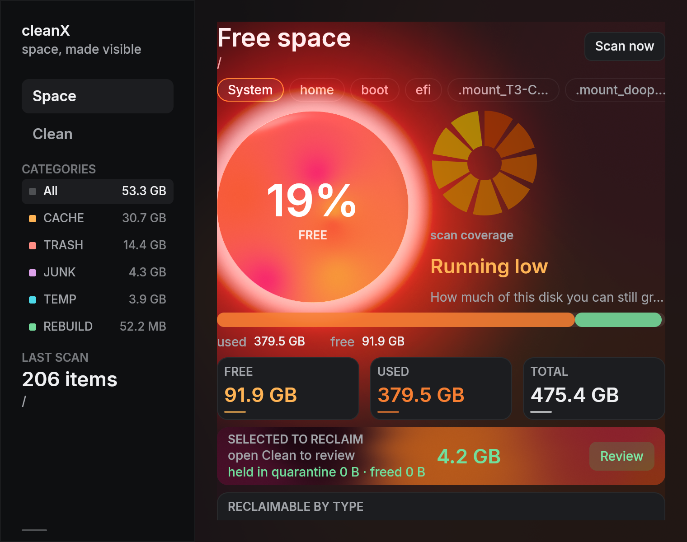
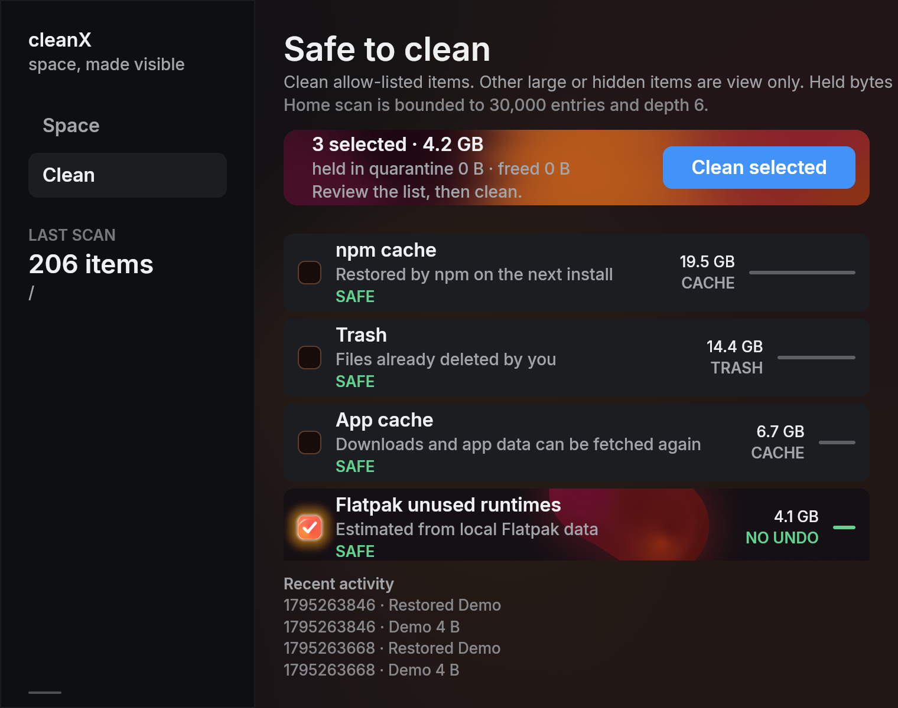
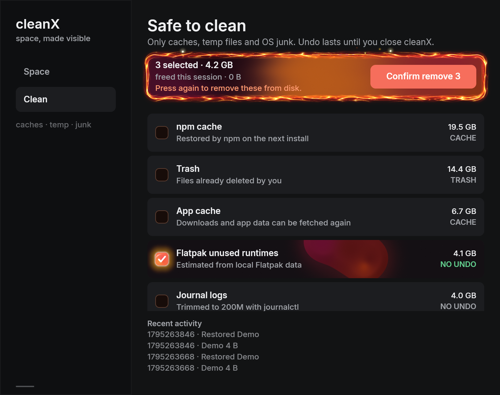
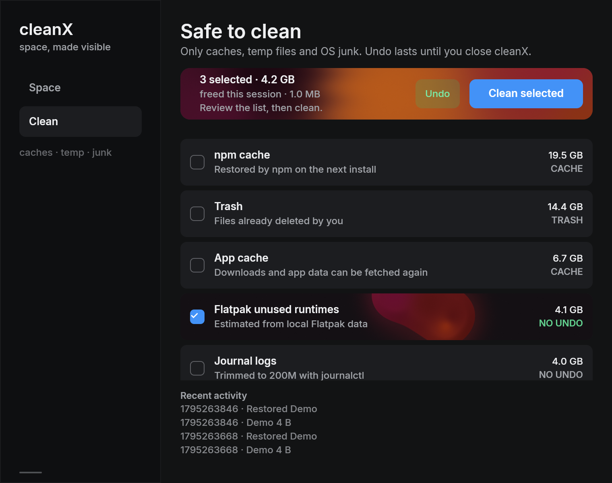

# cleanX

A small [Rune](https://github.com/anomalyco/rune) app that shows free disk space and lists files you can safely remove.

## Overview

These are real snapshots from the app's headless renderer.

| | |
| --- | --- |
| **Free space dashboard**<br>The lava orb warms as the disk fills. Pills switch disks. Drag the ring to spin it, and Scan spins it faster as the sunburst grows.<br> | **Safe-to-clean list**<br>Caches, temp files and junk with sizes and safety notes. Selected rows carry a lava tick.<br> |
| **Two-press safety**<br>The first press arms the action. The second removes the checked rows.<br> | **Undo**<br>Path items move to quarantine and restore until you clear them.<br> |

Regenerate them with `cargo run -- --snap assets/space.png` and, for the others, add `--scene clean`, `--scene confirm` or `--scene undo`.

## What it does

The Space tab draws a lava orb that shows free space and warms as the disk fills. Drag the ring to spin it. Press Scan now to spin it faster as the sunburst grows. Pills switch between disks.

The Clean tab lists known caches, temp folders, trash, `.DS_Store` files, `node_modules` folders, and large or hidden files it finds under home. On Fedora it also lists the dnf package cache, journal logs and unused Flatpak runtimes. Select rows, arm the action, then press again to clean. Path items move to quarantine and get an Undo button. Protected folders such as `.config` and `.ssh` are reported but never offered. System tools do not get undo.

## Download (no setup needed)

Grab a binary from the [Releases page](https://github.com/ChindanaiNaKub/cleanx/releases). No Rust or git needed.

- **Windows:** download `cleanx-windows-x86_64.exe` and double-click it.
- **macOS (Intel and Apple Silicon) and Linux x86_64:** run `curl -fsSL https://raw.githubusercontent.com/ChindanaiNaKub/cleanx/main/scripts/install-binary.sh | bash`.

The script puts `cleanx` in `~/.local/bin`. Add that folder to your `PATH`.

Binaries are built in CI for Linux, Windows, macOS Intel and macOS Apple Silicon. The app runs on real hardware on Linux, macOS and Windows. See Platform support.

Found a bug? [Open an issue](https://github.com/ChindanaiNaKub/cleanx/issues). Include your OS, how you installed the app, and what you expected. Back up files you cannot afford to lose before you clean.

## Run it

One command gets the pinned Rune tree, builds, and installs `cleanx` into `~/.local/bin`. Add that folder to your `PATH`. The build needs nightly Rust.

```bash
git clone https://github.com/ChindanaiNaKub/cleanx.git && cd cleanx && bash scripts/install.sh
```

From a checkout next to `../rune-src`, `cargo run --` starts the app without installing.

Scenes render headlessly with `cargo run -- --snap out.png --scene clean`, or with `cleanx --snap out.png --scene clean` from a downloaded binary. Scenes are `clean`, `confirm`, `burst`, `burst-control`, `undo`, `empty`, `low` and `isolated`. Run `cargo test` for unit tests. Run `scripts/verify.sh` to check formatting, tests and every scene.

## Platform support

- Fedora, today. The full clean list and the dnf, journalctl and Flatpak tools work here.
- Linux, today. The dashboard and the cache, temp and trash list work on any Unix-like system with `df`.
- macOS, today. Tested on Apple Silicon with the Metal backend. An Intel binary is available too. The allow-list covers Caches, Logs and Trash.
- Windows, today. Tested on real hardware with the DirectX 12 backend. The allow-list covers the temp folder and reads `USERPROFILE`.

## How it stays safe

- Cleaning takes two presses. The first arms the action. The second acts on the checked rows.
- Path items move to `~/.local/share/cleanx/quarantine`, not to the trash. Undo restores them until you press Clear held. A manifest lets a new session rebuild the held list. Clearing held cannot be undone and adds those bytes to Freed.
- Only paths under your home directory move. Symlinks and paths whose real location is outside home are refused.
- System targets run their owning tool: `dnf clean packages`, `journalctl --vacuum-size=200M` and `flatpak uninstall --unused`. Privileged tools go through `pkexec`. If that fails, the notice shows a `sudo` command to copy into a terminal. No shell is used.
- The list is a fixed rule set. Caches and rebuild outputs are unchecked by default. Large and hidden files are marked CAUTION and unchecked. `node_modules` and Rust toolchains are marked CAUTION. Protected folders are marked HANDS OFF and cannot be selected.
- Every successful clean appends a line to `~/.local/share/cleanx/history.log`.

## Limitations

- Disk totals come from `df -kP`. The Space tab needs a Unix-like system. The Clean tab uses `HOME` or `USERPROFILE` and works where those are set.
- Scanning happens at startup and on demand. The app does not watch the disk live.
- System targets appear only when `dnf`, `journalctl` or `flatpak` is on `PATH`. Privileged targets need a polkit agent for `pkexec`. The Flatpak size is an estimate from local Flatpak data.
- The scanner follows no symlinks. Discovery stops at 30,000 entries and size counting at 40,000 files. Reported sizes may be samples for very large trees.
- Held items survive a restart but stay on disk until you clear them. Clearing held cannot be undone.
- Category totals cover home only. They are not the whole volume's used space from `df`.
- The app needs a GPU with a supported backend: Vulkan on Linux, Metal on macOS and DirectX 12 on Windows. Headless snapshots use the same renderer.
- No build command or test removes a file. Only a confirmed clean moves path items to quarantine.

## Contributing

Want to help? Read [CONTRIBUTING.md](CONTRIBUTING.md) for setup, checks and the safety rules.
